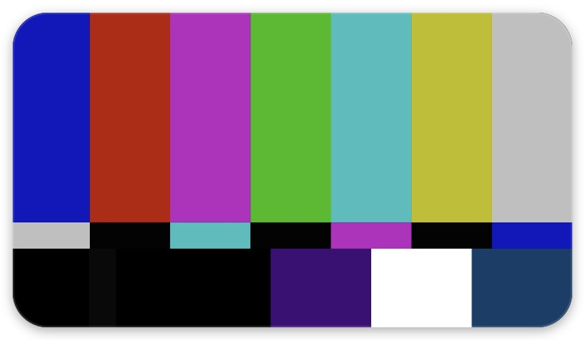
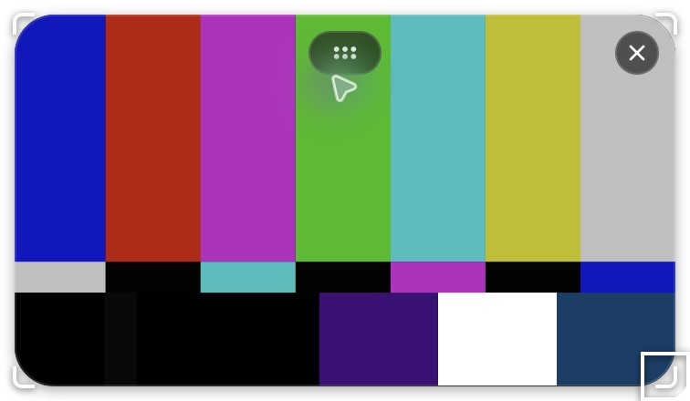

# Floating camera preview screenshots

These are real screenshots of the macOS Electron source build, using a **synthetic SMPTE
color-bar camera**. They contain no physical camera feed or desktop capture. They demonstrate
the interface; the physical-camera and ScreenCaptureKit checks are logged separately in the
[manual E2E checklist](../../manual-e2e-checklist.md).

| Idle: no header or persistent controls | Controls on hover or keyboard focus |
| --- | --- |
|  |  |

To reproduce with a built source checkout and ffmpeg:

```sh
ffmpeg -f lavfi -i smptebars=size=1280x720:rate=30 -t 1 -pix_fmt yuv420p /tmp/camera-demo.y4m
mkdir -p /tmp/openscreen-camera-demo
printf '%s\n' '{"camEnabled":true,"camQuality":"1080p","micEnabled":false,"systemAudioEnabled":false}' > /tmp/openscreen-camera-demo/recording-settings.json
npx electron . --user-data-dir=/tmp/openscreen-camera-demo \
  --use-fake-device-for-media-stream \
  --use-file-for-fake-video-capture=/tmp/camera-demo.y4m \
  --use-fake-ui-for-media-stream
```

Use **View → Show camera preview** to focus the window. Hover to reveal the handles, or Tab
through the controls and use arrow keys (Shift for larger steps). The close control hides the
preview without disabling camera recording. Camera off/on or **View → Show camera preview**
reopens it; entering Studio also restores it when Camera is enabled.
